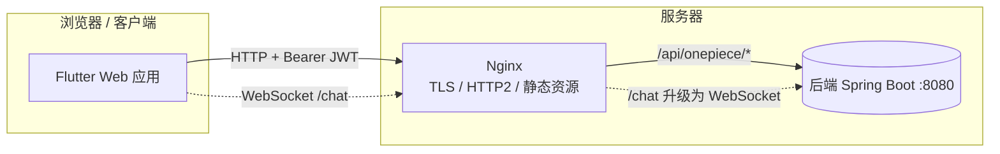
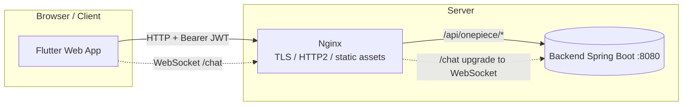

<div align="center">

# ⚓ One Piece Battles · Frontend (Flutter)

**海贼王百科 & 对战模拟平台的前端应用**
**Frontend app for the One Piece encyclopedia & battle-simulation platform**

线上站点 / Live site：**[onepiece-battles.com](https://onepiece-battles.com)**

[]()
[]()
[]()
[]()
[]()
[]()
[]()

**[简体中文](#简体中文)** · **[English](#english)**

</div>

---

<a name="简体中文"></a>

## 简体中文

### 📖 项目简介

**One Piece Battles** 是一个以《海贼王》为主题的百科与对战模拟网站。本仓库是该网站的**前端应用**，基于 **Flutter + Dart** 构建，采用**跨平台单一代码库**（主要面向 **Web**，同时保留 iOS / Android / macOS / Linux / Windows 工程）。

前端通过一个由 **OpenAPI 契约自动生成的 Dart API 客户端**与[后端服务](https://onepiece-battles.com)通信，使用 **JWT** 携带鉴权凭证，通过 **WebSocket** 实现实时聊天，并内置**中英文双语**界面。

> 💡 接口契约以 Git Submodule（`onepiece-battles-api`）形式引入，与后端共用同一份 OpenAPI 定义，保证前后端接口一致。

### ✨ 核心功能

| 模块 | 功能 |
| --- | --- |
| 👤 **登录与账号** | 游客登录 / 注册 / 登录、找回密码、个人主页与资料设置、闲置自动登出 |
| 🧑‍🚀 **角色（Character）** | 浏览 / 搜索 / 创建 / 编辑角色，查看角色详情与属性面板 |
| 🍎 **恶魔果实（Fruit）** | 浏览 / 创建果实，查看当前与历史拥有者 |
| 🏴‍☠️ **海贼团（Group）** | 创建 / 编辑海贼团，管理团员与嵌套子团队 |
| ⚔️ **战斗（Battle）** | 发起单挑 / 团战，回合制战斗过程可视化、战斗数据图表（fl_chart） |
| 🤝 **好友与聊天（Chatting）** | 添加好友、创建 / 加入群聊、实时收发消息、消息撤回、Emoji 表情、图片消息 |
| 🔔 **通知（Notification）** | 好友 / 战斗等事件的实时通知提醒 |
| 🐛 **问题反馈（Issue）** | 提交与浏览反馈 |
| 🔎 **搜索** | 各资源列表支持关键字与多维筛选 |
| 🌏 **国际化** | 中文（zh-CN）/ 英文（en-US）一键切换，默认中文 |
| 📱 **响应式布局** | 自适应桌面端与移动端布局 |

### 🧱 技术栈

| 分类 | 技术选型 |
| --- | --- |
| 框架 / 语言 | Flutter（Dart SDK ≥ 3.4）、跨平台（Web 优先） |
| 状态管理 | `flutter_bloc`（BLoC）+ `provider`（ChangeNotifier） |
| 依赖注入 | `get_it`（服务定位器） |
| 路由 | `go_router`（嵌套路由 + Web 路径策略 `url_strategy`） |
| 接口客户端 | OpenAPI 自动生成的 `openapi` Dart 包（`build_runner` + `openapi_generator`） |
| 网络 / 实时 | `http`、`web_socket_channel`（实时聊天） |
| 鉴权存储 | `flutter_secure_storage`、`shared_preferences`（JWT 令牌持久化） |
| 国际化 | `flutter_localizations` + `intl` + ARB（`flutter gen-l10n`） |
| UI / 组件 | `flutter_svg`、`cached_network_image`、`fl_chart`、`data_table_2`、`dropdown_search`、`emoji_picker_flutter`、`popover`、`flutter_native_splash` |
| 图片 | `image_picker` / `image_picker_for_web`、`cached_network_image` |
| 部署 | Docker（多阶段构建）+ Nginx（反向代理 + TLS/HTTP2） |

### 🏗️ 架构设计

#### 分层结构

- **视图层 `lib/views/`**：按业务划分 `character` / `fruit` / `battle` / `group` / `chatting` / `issue` / `user`，每个模块包含列表页、详情页、创建页。
- **仓库层 `lib/repository/`**：各资源的 DAO（`user_dao`、`character_dao`、`battle_dao`、`chatting_dao`、`message_dao`…）封装生成的 API 客户端，向上提供领域方法。
- **组件层 `lib/components/`**：可复用组件（表单卡片、图片懒加载、消息气泡、`web_socket_service`、`chat_notifier` 等）。
- **配置 `lib/config/`**：`api_initializer`（登录后按 JWT 重建 API 客户端）、`onepiece_api_config`（后端地址）、`resource_permission_manager`（前端权限感知）、`configure_web`。
- **常量 `lib/constants/`**：颜色、字体、路由路径、设备类型（响应式）。
- **国际化 `lib/l10n/`**：`app_en.arb` / `app_zh.arb` 及生成的本地化代码。

#### 前后端协作



- Nginx 托管 Flutter Web 构建产物，并将 `/api/onepiece/` 与 `/chat` 反向代理到后端 `backend:8080`（`/chat` 保留 WebSocket 升级头）。
- 登录成功后，`ApiInitializer.initAuthInfo(token)` 使用 `HttpBearerAuth` 重建 `ApiClient`，后续所有请求自动携带 JWT。

### 🌏 国际化

- 支持语言：`en-US`、`zh-CN`，默认 `zh-CN`；通过 `MyApp.setLocale(...)` 运行时切换。
- 文案维护在 `lib/l10n/app_en.arb` 与 `app_zh.arb`，执行 `flutter gen-l10n` 生成 `AppLocalizations`。

### 🚀 快速开始

#### 环境要求

- Flutter SDK（Dart ≥ 3.4；镜像构建使用 Flutter 3.38.x）
- 已启用 Web 支持：`flutter config --enable-web`

> 🇨🇳 如遇依赖下载问题，可配置国内镜像：
> ```bash
> export PUB_HOSTED_URL=https://pub.flutter-io.cn
> export FLUTTER_STORAGE_BASE_URL=https://storage.flutter-io.cn
> ```

#### 拉取代码（含子模块）

```bash
git clone --recurse-submodules <repo-url>
cd frontend
git submodule update --init --recursive   # 若已克隆但未拉取子模块
```

#### 安装依赖与生成代码

```bash
flutter pub get
./generate.sh        # 依据 OpenAPI 契约生成 API 客户端（build_runner）
flutter gen-l10n     # 生成本地化文件（如未随 build 自动生成）
```

#### 本地运行

```bash
flutter run -d web-server --web-port 1234 --web-hostname local.onepiece-battles.com
```

浏览器访问 `http://local.onepiece-battles.com:1234`。本地开发需要一个可用的后端服务（默认代理到 `backend:8080`，可按需调整 `lib/config/onepiece_api_config.dart` 中的后端地址）。

#### 构建 Web 产物

```bash
flutter build web
# 产物位于 build/web/
```

#### Docker 部署

```bash
# 见 deploy.sh：生成代码 → 多阶段构建 Web → Nginx 镜像 → 推送至阿里云 ACR
./deploy.sh
```

Nginx 需在运行时挂载 TLS 证书（不打进镜像），示例：

```bash
docker run -p 443:443 \
  -v /path/to/www.onepiece-battles.com.pem:/etc/nginx/ssl/www.onepiece-battles.com.pem \
  -v /path/to/www.onepiece-battles.com.key:/etc/nginx/ssl/www.onepiece-battles.com.key \
  <image>:<tag>
```

### 📂 目录结构

```
frontend/
├── lib/
│   ├── main.dart               # 入口：DI、Provider、MaterialApp.router、i18n
│   ├── app_router.dart         # go_router 路由表
│   ├── login_page.dart / register_page.dart / retrieve_password.dart
│   ├── home_page.dart / personal_home.dart
│   ├── views/                  # 各业务模块页面
│   ├── repository/             # 各资源 DAO（封装生成的 API 客户端）
│   ├── components/             # 可复用 UI 组件 + WebSocket 服务
│   ├── config/                 # API 初始化 / 后端地址 / 权限 / Web 配置
│   ├── constants/              # 颜色、字体、路由路径、设备类型
│   ├── popup/                  # 弹窗组件
│   └── l10n/                   # 国际化 ARB 与生成文件
├── generated/                  # OpenAPI 自动生成的 Dart API 客户端
├── onepiece-battles-api/       # Git Submodule：OpenAPI 接口定义
├── asset/                      # 图片、SVG 等静态资源
├── web/ ios/ android/ macos/ linux/ windows/   # 各平台工程
├── pubspec.yaml                # 依赖与资源声明
├── l10n.yaml                   # 本地化配置
├── generate.sh                 # 代码生成脚本
├── Dockerfile / nginx.conf / deploy.sh
```

<div align="right"><a href="#-one-piece-battles--frontend-flutter">↑ 返回顶部 / Back to top</a></div>

---

<a name="english"></a>

## English

### 📖 Overview

**One Piece Battles** is a *One Piece*-themed encyclopedia and battle-simulation website. This repository is the site's **frontend app**, built with **Flutter + Dart** as a **single cross-platform codebase** (primarily targeting **Web**, with iOS / Android / macOS / Linux / Windows projects retained).

The frontend talks to the [backend service](https://onepiece-battles.com) through a **Dart API client auto-generated from the OpenAPI contract**, carries auth via **JWT**, powers real-time chat over **WebSocket**, and ships a **bilingual (Chinese / English)** UI.

> 💡 The API contract is included as a Git submodule (`onepiece-battles-api`), shared with the backend from a single OpenAPI definition to keep both sides in sync.

### ✨ Features

| Module | Capabilities |
| --- | --- |
| 👤 **Auth & Account** | Guest login / register / log in, password recovery, personal home & profile settings, idle auto-logout |
| 🧑‍🚀 **Characters** | Browse / search / create / edit characters, detail view with attribute panels |
| 🍎 **Devil Fruits** | Browse / create fruits, view current and historical owners |
| 🏴‍☠️ **Pirate Crews (Groups)** | Create / edit crews, manage members and nested sub-groups |
| ⚔️ **Battles** | Start 1v1 / team battles, visualized round-based process, battle charts (fl_chart) |
| 🤝 **Friends & Chat** | Add friends, create / join group chats, real-time messaging, message retraction, emoji, image messages |
| 🔔 **Notifications** | Real-time alerts for friend / battle events |
| 🐛 **Issue Feedback** | Submit and browse issues |
| 🔎 **Search** | Keyword and multi-dimensional filtering across resource lists |
| 🌏 **Internationalization** | One-tap switch between Chinese (zh-CN) and English (en-US); Chinese by default |
| 📱 **Responsive Layout** | Adapts between desktop and mobile layouts |

### 🧱 Tech Stack

| Area | Technology |
| --- | --- |
| Framework / Language | Flutter (Dart SDK ≥ 3.4), cross-platform (web-first) |
| State Management | `flutter_bloc` (BLoC) + `provider` (ChangeNotifier) |
| Dependency Injection | `get_it` (service locator) |
| Routing | `go_router` (nested routes + web path strategy via `url_strategy`) |
| API Client | Auto-generated `openapi` Dart package (`build_runner` + `openapi_generator`) |
| Networking / Realtime | `http`, `web_socket_channel` (real-time chat) |
| Auth Storage | `flutter_secure_storage`, `shared_preferences` (JWT persistence) |
| Internationalization | `flutter_localizations` + `intl` + ARB (`flutter gen-l10n`) |
| UI / Widgets | `flutter_svg`, `cached_network_image`, `fl_chart`, `data_table_2`, `dropdown_search`, `emoji_picker_flutter`, `popover`, `flutter_native_splash` |
| Images | `image_picker` / `image_picker_for_web`, `cached_network_image` |
| Deployment | Docker (multi-stage build) + Nginx (reverse proxy + TLS/HTTP2) |

### 🏗️ Architecture

#### Layered structure

- **View layer `lib/views/`** — organized by feature (`character` / `fruit` / `battle` / `group` / `chatting` / `issue` / `user`), each with list, detail and create pages.
- **Repository layer `lib/repository/`** — per-resource DAOs (`user_dao`, `character_dao`, `battle_dao`, `chatting_dao`, `message_dao`, …) wrap the generated API client and expose domain methods.
- **Component layer `lib/components/`** — reusable widgets (form cards, lazy image loaders, message bubbles, `web_socket_service`, `chat_notifier`, …).
- **Config `lib/config/`** — `api_initializer` (rebuilds the API client with the JWT after login), `onepiece_api_config` (backend base URL), `resource_permission_manager` (frontend permission awareness), `configure_web`.
- **Constants `lib/constants/`** — colors, fonts, route paths, device type (responsive).
- **i18n `lib/l10n/`** — `app_en.arb` / `app_zh.arb` and generated localization code.

#### Frontend ↔ Backend



- Nginx serves the Flutter web build and reverse-proxies `/api/onepiece/` and `/chat` to `backend:8080` (`/chat` preserves the WebSocket upgrade headers).
- On successful login, `ApiInitializer.initAuthInfo(token)` rebuilds the `ApiClient` with `HttpBearerAuth`, so every subsequent request carries the JWT automatically.

### 🌏 Internationalization

- Supported locales: `en-US`, `zh-CN`, defaulting to `zh-CN`; switched at runtime via `MyApp.setLocale(...)`.
- Strings live in `lib/l10n/app_en.arb` and `app_zh.arb`; run `flutter gen-l10n` to generate `AppLocalizations`.

### 🚀 Getting Started

#### Prerequisites

- Flutter SDK (Dart ≥ 3.4; image builds use Flutter 3.38.x)
- Web enabled: `flutter config --enable-web`

> 🇨🇳 If dependency downloads are slow, use China mirrors:
> ```bash
> export PUB_HOSTED_URL=https://pub.flutter-io.cn
> export FLUTTER_STORAGE_BASE_URL=https://storage.flutter-io.cn
> ```

#### Clone (with submodules)

```bash
git clone --recurse-submodules <repo-url>
cd frontend
git submodule update --init --recursive   # if cloned without submodules
```

#### Install deps & generate code

```bash
flutter pub get
./generate.sh        # generate the API client from the OpenAPI contract (build_runner)
flutter gen-l10n     # generate localization files (if not produced by the build)
```

#### Run locally

```bash
flutter run -d web-server --web-port 1234 --web-hostname local.onepiece-battles.com
```

Open `http://local.onepiece-battles.com:1234`. Local development needs a running backend (proxied to `backend:8080` by default; adjust the base URL in `lib/config/onepiece_api_config.dart` as needed).

#### Build web output

```bash
flutter build web
# Output in build/web/
```

#### Docker deployment

```bash
# See deploy.sh: generate code → multi-stage web build → Nginx image → push to Alibaba Cloud ACR
./deploy.sh
```

Nginx expects TLS certificates mounted at runtime (not baked into the image), e.g.:

```bash
docker run -p 443:443 \
  -v /path/to/www.onepiece-battles.com.pem:/etc/nginx/ssl/www.onepiece-battles.com.pem \
  -v /path/to/www.onepiece-battles.com.key:/etc/nginx/ssl/www.onepiece-battles.com.key \
  <image>:<tag>
```

### 📂 Project Layout

```
frontend/
├── lib/
│   ├── main.dart               # Entry: DI, Provider, MaterialApp.router, i18n
│   ├── app_router.dart         # go_router route table
│   ├── login_page.dart / register_page.dart / retrieve_password.dart
│   ├── home_page.dart / personal_home.dart
│   ├── views/                  # Feature pages
│   ├── repository/             # Per-resource DAOs (wrap the generated API client)
│   ├── components/             # Reusable UI widgets + WebSocket service
│   ├── config/                 # API init / backend URL / permissions / web config
│   ├── constants/              # Colors, fonts, route paths, device type
│   ├── popup/                  # Dialog widgets
│   └── l10n/                   # i18n ARB & generated files
├── generated/                  # OpenAPI-generated Dart API client
├── onepiece-battles-api/       # Git submodule: OpenAPI contract
├── asset/                      # Images, SVGs and other static assets
├── web/ ios/ android/ macos/ linux/ windows/   # Per-platform projects
├── pubspec.yaml                # Dependencies & asset declarations
├── l10n.yaml                   # Localization config
├── generate.sh                 # Codegen script
├── Dockerfile / nginx.conf / deploy.sh
```

<div align="right"><a href="#-one-piece-battles--frontend-flutter">↑ Back to top / 返回顶部</a></div>

---

<div align="center">

*本项目仅为《海贼王》主题的技术学习与演示用途，与东映动画 / 集英社无任何官方关联。*
*This project is a technical study/demo built around a One Piece theme and is not officially affiliated with Toei Animation or Shueisha.*

</div>
